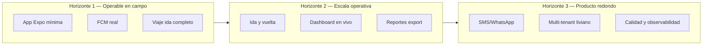

# Plan de desarrollo y mejoras — RutaSegura

**Versión:** 1.0  
**Fecha:** marzo 2026  
**Alcance de este repo:** panel web + API REST (`/api/v1`)  
**Alcance del producto completo:** panel + app transportista (Expo) + alertas a familiares

---

## Progreso de implementación (repo admin)

Última actualización: **noviembre 2026**. Marca lo aplicado en código; lo pendiente sigue en el backlog de cada fase.

| ID | Entrega | Estado | Notas |
|----|---------|--------|--------|
| A3 | Healthcheck `GET /api/v1/health` | ✅ | Público en `proxy.ts` |
| A5 | Seed no destructivo | ✅ | `PRISMA_SEED_DESTRUCTIVE=false` |
| A2 | Doc viva / histórico | ✅ parcial | `estado-proyecto.md` marcado histórico; endpoints actualizados |
| A1 | Migraciones versionadas | ⏳ | Sigue `db push` en Vercel; ver `sync_schema_operativo.sql` |
| A4 | Errores API consistentes | ⏳ | Mejora incremental en handlers nuevos |
| B2 | `fcmToken` en contacto | ✅ | Schema + Zod pasajero |
| B3 | Plantillas español | ✅ | `plantillasNotificacion.ts` |
| B4 | Umbrales por env | ✅ | `configOperativa.ts` + `GET /config/operativa` |
| B1 | FCM HTTP v1 | ⏳ | Legacy `FCM_SERVER_KEY` en `fcm.ts` |
| B5 | Cola / reintentos | ⏳ | |
| C | `GET /viajes/hoy`, auth viaje, rate limit | ✅ | `fechaChile`, `viajeAutorizacion`, 429 location |
| D1 | UI unificada | ✅ parcial | `PageHeader` en pasajeros, notificaciones, settings |
| D2 | Crear viaje en panel | ✅ | Modal en `/trips` |
| D3 | Mapa dashboard EN_CURSO | ✅ | Leaflet + `posicionesEnCurso` en resumen |
| D5 | Settings umbrales/FCM | ✅ parcial | Solo lectura vía API operativa |
| D6 | Export CSV reportes | ✅ | Botón Excel → CSV |
| E2/E5 | Vuelta / LLEGADA_DESTINO | ✅ parcial | Lógica en `procesarUbicacionViaje.ts` |
| Backlog §5 índices | Prisma | ✅ | `Viaje`, `Pasajero`, `NotificacionLog` |
| §9 MVP Runbook | Documento | ✅ | [`runbook-mvp.md`](./runbook-mvp.md) |
| Fase C Expo | App móvil | ❌ | Fuera de este repo |
| B1 FCM v1, F2 SMS, tests F5 | — | ❌ / ⏳ | Siguiente horizonte |

**Checklist piloto (§9):**

- [x] Schema sincronizado (push automatizado + SQL rescate)
- [ ] App móvil GPS ≤15 s
- [ ] Push FCM a dispositivo de prueba (requiere token + `FCM_SERVER_KEY`)
- [x] Panel viaje en curso + log notificaciones
- [x] Admin CRUD ruta/paradas sin DB manual
- [x] Runbook FCM/DB

---

## 1. Norte del producto

RutaSegura existe para que operadores de **transporte escolar o particular** planifiquen rutas con paradas ordenadas, ejecuten **viajes diarios** con el conductor en ruta, y que **contactos de confianza** (padres, tutores) reciban avisos automáticos cuando el vehículo **se acerca** o **llega** al domicilio o destino, sin tener que llamar al transportista.

El valor no está solo en “tener un CRUD”, sino en **cerrar el ciclo**:

```text
Planificar → Ejecutar viaje → GPS en ruta → Decidir proximidad → Notificar → Auditar
```

**Principios para priorizar trabajo**

1. **Operación primero:** lo que usa el transportista un lunes a las 7:00.
2. **Confiabilidad sobre features:** schema de DB alineado, auth estable, idempotencia en alertas.
3. **Mismo contrato API** para web y app móvil (documentación en `documentacion_endpoints.md`).
4. **Chile / español:** textos, horarios y UX familiar para el mercado local.

---

## 2. Línea base (estado real del código)

| Capa | Madurez | Qué hay hoy |
|------|---------|-------------|
| Auth + API Key | Alta | Login/registro, hash en DB, `AuthGate`, filtro por rol |
| Maestros (pasajeros, rutas, paradas) | Alta | CRUD, mapas Leaflet, paradas y ruta OSRM en admin |
| Viajes + GPS (backend) | Media | CRUD viajes, `POST .../location`, Haversine, `NotificacionLog` |
| Notificaciones reales | Baja | Registro en DB; FCM mock sin `FCM_SERVER_KEY`; sin Twilio |
| Panel (KPIs, reportes, viajes) | Media | Datos reales; export PDF/Excel placeholder |
| App transportista | Nula | Fuera de este repo |
| CI / tests | Baja | `lint` + `build` manual; sin tests automatizados |
| Migraciones DB | Media | `prisma db push` en `vercel-build`; SQL manual de respaldo |

**Riesgos conocidos**

- Desfase schema ↔ producción (mitigado con `vercel-build` + `prisma/sql/sync_schema_operativo.sql`).
- API Key invalidada en cada login (comportamiento actual; documentar para móvil).
- `validarApiKey` con costo O(n) en keys antiguas.

---

## 3. Visión por horizonte



| Horizonte | Objetivo de negocio | Indicador de éxito |
|-----------|---------------------|-------------------|
| **H1** (4–8 sem) | Un conductor puede hacer un viaje real y la familia recibe al menos un push de prueba | 1 ruta de campo sin errores 500 |
| **H2** (8–14 sem) | Admin ve operación del día y puede auditar puntualidad | Dashboard con posición + reporte semanal |
| **H3** (14+ sem) | Canales alternativos y operación multi-flota | SMS opcional + 2 transportistas aislados en datos |

---

## 4. Plan por fases

### Fase A — Consolidación técnica (semana 1–2)

**Objetivo:** que ningún deploy vuelva a romper módulos por schema ni confusión de roles.

| # | Entrega | Detalle |
|---|---------|---------|
| A1 | Migraciones Prisma versionadas | Sustituir o complementar `db push` con `prisma migrate` en entornos staging/prod |
| A2 | Documentación viva | Mantener alineados `README.md`, `AGENTS.md` y este plan; marcar `estado-proyecto.md` como histórico o actualizarlo |
| A3 | Healthcheck API | `GET /api/v1/health` (DB ping, versión commit) para Vercel y monitoreo |
| A4 | Errores API consistentes | `{ error: string }` o Zod issues; no filtrar `password`/`apiKey` en respuestas |
| A5 | Seed por entorno | Flag para seed no destructivo en staging |

**Criterio de salida:** deploy en Vercel + login transportista + listados 200 en pasajeros/rutas/viajes/dashboard.

---

### Fase B — Motor de notificaciones productizable (semana 2–4)

**Objetivo:** que una alerta “en camino / en puerta” sea **real** y **no duplicada**.

| # | Entrega | Detalle |
|---|---------|---------|
| B1 | FCM HTTP v1 | Service account en lugar de legacy key; variable `GOOGLE_APPLICATION_CREDENTIALS` o JSON en Vercel |
| B2 | Tokens push por contacto | Campo `fcmToken` en `ContactoNotificacion` (o tabla `DispositivoContacto`) |
| B3 | Plantillas de mensaje | Textos en español por `tipo` (`EN_CAMINO`, `EN_PUERTA`, `LLEGADA_DESTINO`) |
| B4 | Ajuste de umbrales | Parametrizar metros en env o `Settings`; documentar en `procesarUbicacionViaje.ts` |
| B5 | Cola / reintentos | Jobs para `estado: FALLIDO` (Vercel Cron o worker ligero) |

**Idea creativa (sin salir del objetivo):** “Modo silencio nocturno” — no enviar push entre 22:00–06:00 salvo `EN_PUERTA` (configurable por pasajero).

**Criterio de salida:** simulación GPS genera push visible en dispositivo de prueba + registro en `/notifications`.

---

### Fase C — App transportista MVP (semana 4–8, repo Expo)

**Objetivo:** reemplazar la UI `/trips` como herramienta principal del conductor.

| Pantalla | Función |
|----------|---------|
| Login | Misma API `POST /auth/login`; guardar API Key segura (SecureStore) |
| Hoy | Rutas/viajes del día (`GET /viajes` filtrado) |
| Viaje activo | Iniciar/finalizar (`PUT /viajes/:id`) |
| En ruta | Foreground + background location → `POST .../location` cada N s |
| Paradas | Lista ordenada con estado “pendiente / visitada” (derivado de `paradaActualOrden`) |

**Backlog API (este repo si hace falta)**

- `GET /api/v1/viajes/hoy` (fecha local Chile, transportista autenticado).
- Validar que transportista solo actualice **sus** viajes.
- CORS y rate limit suave en `location` (evitar spam).

**Criterio de salida:** viaje `EN_CURSO` en app → al menos una notificación en panel.

---

### Fase D — Experiencia admin y transportista en web (semana 3–6, paralelo)

**Objetivo:** mismo diseño system (`PageHeader`, `StatCard`) en todas las pantallas y menos fricción operativa.

| # | Entrega | Prioridad |
|---|---------|-----------|
| D1 | Unificar UI Pasajeros, Notificaciones, Configuración | Alta |
| D2 | Crear viaje desde panel (elegir ruta + fecha) | Alta |
| D3 | Mapa en dashboard: última posición viajes `EN_CURSO` | Media |
| D4 | Transportistas: invitar/registrar (hoy solo registro público) | Media |
| D5 | Settings: guardar umbrales GPS y toggles FCM (no solo placeholder) | Media |
| D6 | Reportes: export CSV real (PDF después) | Baja |

**Idea creativa:** tarjeta “**Ruta del día**” en dashboard del transportista con cuenta regresiva estimada a la siguiente parada (Haversine + velocidad media configurable, sin Google Maps al inicio).

---

### Fase E — Ida, vuelta y reglas de negocio (semana 6–9)

**Objetivo:** soportar colegio ida/vuelta como en el plan original.

| # | Entrega |
|---|---------|
| E1 | `sentido` en viaje: `IDA` \| `VUELTA` |
| E2 | Coordenadas de parada según sentido (domicilio vs destino) — parcialmente en `procesarUbicacionViaje` |
| E3 | Reordenar paradas automático en vuelta |
| E4 | Modelo: `diasActivos` y `horaEstimada` en ruta/parada (opcional fase 2) |
| E5 | Notificación `LLEGADA_DESTINO` al completar parada en destino |

**Criterio de salida:** un viaje de vuelta con 2 paradas dispara secuencia de alertas coherente.

---

### Fase F — Confianza, compliance y escala (semana 10+)

| # | Tema | Acción |
|---|------|--------|
| F1 | Privacidad | Tracking solo con viaje `EN_CURSO`; política en UI |
| F2 | SMS/WhatsApp | Twilio detrás de feature flag en `ContactoNotificacion.canal` |
| F3 | Email transaccional | Resend/SendGrid para `forgot-password` |
| F4 | Observabilidad | Logs estructurados; opcional Sentry en API |
| F5 | Tests de contrato | Colección Postman o Vitest contra handlers críticos |
| F6 | Multi-transportista admin | Admin asigna pasajeros a transportista; scopes claros |

---

## 5. Backlog técnico transversal

Priorizado para cualquier fase:

1. **Índices Prisma:** `Viaje(estado, fecha)`, `Pasajero(transportistaId)`, `NotificacionLog(enviadoEn)`.
2. **Paginación** en listados largos (`notificaciones`, `viajes`).
3. **Webhook interno** para auditar cambios de estado de viaje.
4. **Versionado API** `/api/v2` solo cuando haya breaking change documentado.
5. **PWA ligera** para transportista en navegador (plan C alternativo si Expo se retrasa).

---

## 6. Métricas sugeridas (cuando haya datos reales)

| Métrica | Uso |
|---------|-----|
| Viajes completados / semana | Reportes operativos |
| % notificaciones `FALLIDO` | Salud FCM |
| Tiempo medio viaje | KPI operación |
| Distancia media última parada vs real | Calibrar umbrales |
| DAU transportistas con GPS activo | Adopción app |

---

## 7. Roadmap visual (12 semanas orientativas)

| Semana | Foco principal |
|--------|----------------|
| 1–2 | Fase A |
| 2–4 | Fase B + inicio D |
| 4–8 | Fase C (Expo) + Fase D |
| 6–9 | Fase E |
| 10+ | Fase F + pulido |

Las semanas son **orientativas**; la dependencia crítica es **B + C** para demostrar valor al cliente final (familia que recibe el aviso).

---

## 8. Qué no hacer (anti-objetivos)

- No construir marketplace pasajero–conductor (fuera de alcance).
- No tracking en tiempo real para padres (solo alertas; privacidad).
- No reescribir a microservicios antes de tener app en campo.
- No añadir pagos/facturación hasta que el loop GPS-notificación sea estable.

---

## 9. Definición de “MVP listo para piloto”

Checklist para un piloto con 1 transportista y 5–10 pasajeros:

- [ ] Schema sincronizado en prod (migrate o push automatizado).
- [ ] App o flujo móvil envía GPS cada ≤15 s en viaje activo.
- [ ] Al menos push FCM a un contacto de prueba.
- [ ] Panel muestra viaje en curso y log de notificaciones.
- [ ] Admin puede corregir ruta/paradas sin tocar DB.
- [ ] Runbook: qué hacer si falla FCM o la DB.

---

## 10. Referencias en el repositorio

| Documento | Uso |
|-----------|-----|
| [README.md](../README.md) | Onboarding humanos |
| [AGENTS.md](../AGENTS.md) | Automatización y convenciones |
| [documentacion_endpoints.md](./documentacion_endpoints.md) | Contrato HTTP |
| [plan-desarrollo-app-transporte.md](./plan-desarrollo-app-transporte.md) | Visión histórica multi-app |
| [prisma/sql/sync_schema_operativo.sql](../prisma/sql/sync_schema_operativo.sql) | Rescate schema en prod |
| [runbook-mvp.md](./runbook-mvp.md) | Piloto y fallos FCM/DB |
| [prisma-migrate.md](./prisma-migrate.md) | Plan migraciones (A1) |

---

## 11. Próximos tres pasos recomendados (acción inmediata)

1. **Configurar FCM** en staging y probar `registrarYEnviarNotificacion` con token real.  
2. **Abrir repo Expo** (o carpeta `apps/mobile`) con login + envío de location contra staging.  
3. **Crear viaje desde panel** y documentar flujo de piloto para María González / Juan Pérez (seed).

---

*Este plan complementa `plan-desarrollo-app-transporte.md`. En caso de conflicto con el código, prevalecen **código + `documentacion_endpoints.md` + `AGENTS.md`**.*